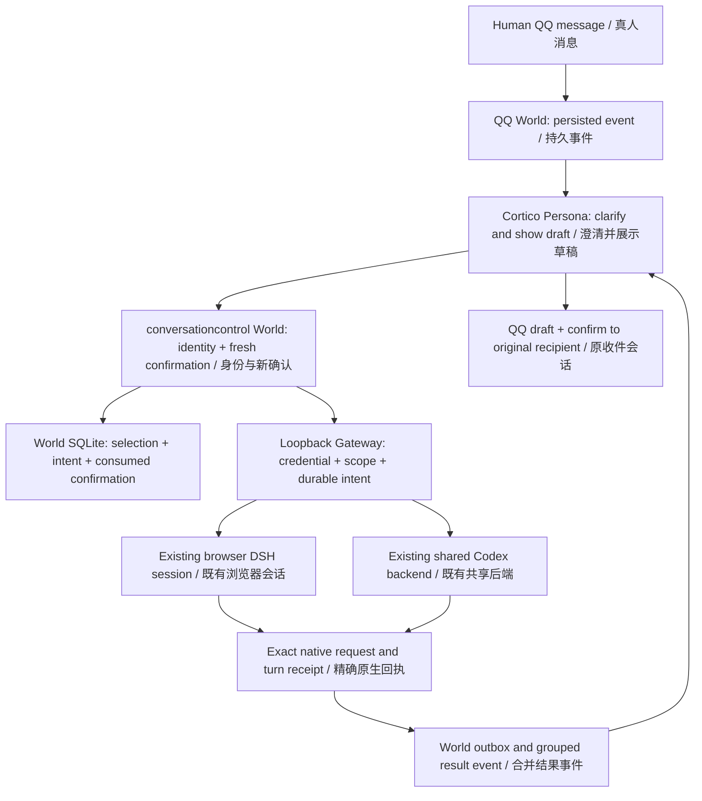

# Cortico ↔ DSH / Codex Conversation Control

**反向会话控制评审候选 / Reverse conversation control review candidate**  
World **0.1.4** · Gateway **0.1.9** · Shared core **0.1.0** · Review date **2026-10-13, Asia/Shanghai**

## 首先阅读：安全风险 / Read first: security risks

**这是能驱动已有 AI 会话执行工作的控制桥接。安装包已通过本机验证，但不是通用安装器，也没有取得完整稳定版验收。建议先在私有仓库评审。**

**This bridge can cause existing AI sessions to perform work. Its packages have been checked on the existing local installation. It is not a universal installer or an accepted stable release. Start with private repository review.**

| 风险 / Risk | 必须理解的边界 / Boundary |
|---|---|
| 网关密钥就是控制权 / The gateway credential grants control | QQ 身份、草稿和新确认由 **World** 校验。持有 Bearer 密钥的本机程序可以直接调用 Gateway；Gateway 不独立复验 QQ。不要共享密钥、开放公网、加公网代理或转发端口。 / The **World** checks QQ identity, drafts and fresh confirmation. A local program holding the Bearer credential can call the Gateway directly; the Gateway does not independently verify QQ consent. Do not share the credential or expose/proxy/forward the service to the internet. |
| 项目授权不是操作系统沙箱 / Delegated roots are not an OS sandbox | DSH `check` 只允许项目内原生 `read`；`continue/send` 继承原生权限，已知文件工具受路径检查。任意 shell、动态工具和外部进程不受本项目完整文件沙箱保证。Codex `check` 是只读指令，不能替代原生只读权限。 / DSH `check` only permits scoped native `read`; `continue/send` inherit native permissions with checks on known file tools. Arbitrary shell commands, dynamic tools and subprocesses are not fully sandboxed by this bridge. Codex `check` requests read-only behavior but does not enforce a read-only native permission preset. |
| 有步数限制仍可能消耗大量 token / Execution budgets are not spending caps | DSH 最多 12 步、16 次模型请求、300 秒；Codex 有具体回合期限，没有同等原生步数/请求数限制。长历史仍可能昂贵。不能自动续预算。 / DSH allows at most 12 steps, 16 model requests and 300 seconds; Codex has an exact-turn deadline without equivalent native step/request caps. Long history can still be expensive. Never renew budgets automatically. |
| 未知结果可能已经执行 / An unknown result may already have executed | 断线、落账失败、缺失原生结束事件都不能通过重发“修复”。保留原 operation/request/turn 身份，只对账；不要换 ID 绕过。 / Disconnects, failed receipt commits and missing native terminal events must not be “fixed” by resubmission. Preserve operation/request/turn identity and reconcile; never evade uncertainty by changing IDs. |
| 依赖本机宿主及内部接口 / Host and internal-protocol dependencies | 桌面 Codex 适配器绑定已验证版本和进程；更新后可能停用。原生 DSH 取消/持久化修复属于宿主，不包含在这两个扩展包里。 / The desktop Codex adapter pins a verified version and process and can stop working after an update. Required native DSH cancellation/persistence fixes are host changes, not part of these extension archives. |
| 数据与回执可能敏感 / State and results can contain private data | 状态库可含正文、回复、QQ 身份及工作区。结果脱敏是模式匹配，不保证识别所有秘密。结果可能发回原 QQ 会话，包括原群聊。 / State can contain prompts, replies, QQ identities and workspaces. Pattern-based result redaction is not exhaustive. Results may return to the originating QQ conversation, including a group. |

当前仍有一次监测查询超时和一次 `blocked` 后错误暗示“等待即可完成”的 Persona 话术问题。不要把通知话术当成原生终态。SHA-256 清单用于完整性比对，不是作者数字签名。

One monitoring read timed out, and Persona once implied that a terminal `blocked` operation would eventually finish by waiting. Treat the native receipt as authoritative. SHA-256 manifests detect changes; they are not author signatures.

## 仓库交付方式 / Repository delivery format

本仓库保存完整目录快照 ZIP、可安装 tgz 和便于在线审阅的文档。**源码、12 个测试文件、构建产物和校验工具都在 ZIP 内**；先下载并解压，再执行后文的相对路径和命令。克隆这个交付仓库也需要解压 ZIP，才能得到完整源码工作目录。ZIP 内 FILE-MANIFEST.json 校验解压目录；仓库 UPLOAD-MANIFEST.json 则记录网页上传文件的哈希。

This repository stores the complete directory snapshot ZIP, installable tgz archives and review documents. **Source code, twelve test files, compiled artifacts and verification tools are inside the ZIP.** Download and extract it before using the paths and commands below. A clone of this delivery repository must also extract the ZIP to obtain the source workspace. FILE-MANIFEST.json inside the ZIP covers the extracted tree; UPLOAD-MANIFEST.json records hashes of the browser-uploaded files.

- [完整源码快照 / Full source snapshot](dsh-cortico-conversation-control-review-20261013-r3.zip) · [ZIP SHA-256](dsh-cortico-conversation-control-review-20261013-r3.zip.sha256)
- [DSH Gateway 0.1.9](dsh-conversation-gateway-0.1.9.tgz)
- [Cortico World 0.1.4](cortico-world-conversation-control-0.1.4.tgz)
- [安装包校验 / Artifact checksums](ARTIFACT-SHA256SUMS.txt)

ZIP SHA-256: `2b0d656edc1c85a0115429f15a1dd7c8a0ec608b989ad9a28124b2c907921279`.

## 1. 本候选包含什么 / Scope and versions

| 模块 / Module | 作用 / Role |
|---|---|
| `cortico-world-conversation-control` 0.1.4 | 独立 Cortico World，API v5，id `conversationcontrol`，六个工具和独立控制台页。 / A separate Cortico World, API v5, with six tools and its own console page. |
| `dsh-conversation-gateway` 0.1.9 | 挂在浏览器 DSH `web` profile 的 Cordis 插件；连接该宿主与明确指定的现有 Codex 后端。 / A Cordis plugin mounted in the browser DSH `web` profile, controlling that host and an explicitly selected existing Codex backend. |
| `conversation-control` 0.1.0 | 身份路由、适配器、HTTP 与 SQLite 共享实现，已打入上述两个包。 / Shared routing, adapters, HTTP and SQLite implementation bundled into the two packages. |
| `artifacts/` | 两个冻结 `.tgz`，保持已校验版本原始字节。 / Two frozen `.tgz` archives retaining their verified original bytes. |
| `tests/` | 12 个隔离测试文件，使用合成输入；部分测试依赖维护者现有宿主。 / Twelve isolated test files using synthetic inputs; some require the maintainer's existing host installation. |

这里只交付**反向会话控制**。不重复交付 `cortico-world-dsh-memory`、`cortico-world-codex-bridge`，也不包含旧 `dshcontrol`、宿主补丁、安装后的部署或数据库。它不是 Cortico 官方发行版。包内和子目录 README 保留历史说明，当前边界以**本 README、SECURITY.md 和 RELEASE-STATUS.md**为准。

This candidate contains **reverse conversation control only**. It does not duplicate `cortico-world-dsh-memory` or `cortico-world-codex-bridge`, and does not include the older `dshcontrol`, host patches, installed deployments or databases. It is not an official Cortico release. Package and component READMEs retain historical notes; **this README, SECURITY.md and RELEASE-STATUS.md** define the current review scope.

### DSH 与 Codex 分别做到哪一步 / DSH and Codex evidence separately

| 对象 / Backend | 已实现及已核验 / Implemented and checked | 仍未证明 / Not established |
|---|---|---|
| 浏览器 DSH / Browser DSH | 查找、选择、check/send/continue/pause、精确 request/turn 对账；近期真人 QQ send 已返回真实 blocked 终态。 / Discovery, selection, native actions and exact receipt reconciliation; a recent genuine QQ send returned a real blocked end. | 该长任务没有完成出包；不能以 send 代替所有动作的当前真人 QQ 验收。 / The long build did not complete; one send does not prove every human QQ action. |
| 现有桌面 Codex / Existing desktop Codex | 同样四种动作的适配器已实现。历史原生 send 得到指定回复，同 ID 保留同 turnId，pause 中断精确回合。2026-10-13 22:52 Asia/Shanghai 只读发现再次 HTTP 200，来源为现有桌面 IPC，无发现错误。 / All four actions are implemented. Prior native send returned the requested marker, same-ID reconciliation preserved turn identity, and pause interrupted the exact turn. Fresh read-only discovery at the stated time returned HTTP 200 from the existing desktop IPC with no discovery error. | 历史原生测试不是来自真人 QQ。此次没有新发模型指令；当前版本的 Codex 真人 QQ 从选定到回执全过程仍需独立验收。 / The historical native test was not QQ-originated. No new model command was sent in this review; current-version Codex human QQ end-to-end acceptance remains separate. |

| 宿主形态 / Host form | 支持边界 / Support boundary |
|---|---|
| DSH 浏览器 web profile / Browser web profile | 已挂载并有真人 QQ 控制证据。 / Mounted with real human QQ control evidence. |
| 官方 DSH 桌面 / Official DSH desktop | 源码共用 Cordis Host、profile boot 和核心会话服务，因此有复用基础；当前 Gateway 缺少官方桌面要求的 `dsh.bundle.patch` 安装注册，桌面安装器不接本地 `file:`/tgz。尚未适配和验收。 / Source shares the Cordis Host, profile boot and core session services. Reuse is feasible, but this Gateway lacks the desktop-required bundle registration; the desktop installer does not accept the current local archive workflow. Not yet adapted or accepted. |
| EAC | 本次未确认对应应用与版本；需要先确认 Host/协议，不能声称兼容或不兼容。 / Application and version are not identified; host/protocol verification is required before claiming compatibility. |
| 官方 Codex 桌面 / Official Codex desktop | Windows 现有桌面版本锁定 IPC 已实现；与 DSH 桌面适配是不同接口。 / Implemented through pinned Windows desktop IPC; separate from DSH desktop support. |

DSH 控制代码调用宿主服务，不依赖网页 DOM。官方 DSH 桌面插件接入时还需决定是否允许网关新增 loopback 监听；不能把宿主原有“不开放 Web 端口”的描述直接套用到安装网关之后。

DSH control uses host services rather than webpage DOM. A future official desktop integration must explicitly account for the additional loopback listener; the original host's no-Web-listener claim does not automatically cover an installed Gateway.

Codex 的正常新回合要求目标 idle；不会向正在工作的对话强塞继续指令。权限审批由原生宿主决定；未装载的冷会话需要现有桌面 owner，无法读取时明确不可用。本项目不支持远程云端任意 Codex、所有机器或自动接管全部窗口。

A new Codex turn requires an idle target; the adapter does not steer a busy turn with a new continue command. Native approval remains with the host. Cold conversations require an existing desktop owner and can be unavailable. This is not control of arbitrary cloud Codex tasks, every machine or all windows automatically.

## 2. 工作机制 / How it works



QQ World 先保存真实 `qq.message`。模型工具传入可见 `#message_id` 的数值作为 `originMessageId`，World 再从事件库解析唯一、未过期的真实事件和内部 cursor。**消息 ID 不等于事件 cursor**；不要猜数字、取负数重试或自动换用最新消息。

The QQ World first persists the actual `qq.message`. Tools use the visible numeric `#message_id` as `originMessageId`; the control World resolves the unique, fresh event and its internal cursor. **A message ID is not an event cursor.** Do not guess numbers, retry the opposite sign or fall back to the latest message.

Persona 根据标题、工作区和聊天活动时间澄清用户意图。底层查找是字面子串匹配，不是全盘全文/向量搜索；最多五个候选。Gateway 0.1.9 的 DSH 查找只使用缓存元数据，可能返回缺失标题和 `stateVerification=deferred`，草稿阶段再核验精确原生状态。聊天活动时间不能证明文件最近修改时间。

Persona clarifies intent using titles, workspaces and chat activity. Backend search uses literal substrings, not full-disk conversation-text or vector search, and returns at most five candidates. Gateway 0.1.9 uses cached DSH metadata during discovery; titles may be missing and state may be `deferred` until the draft's exact native check. Chat activity does not prove when files were modified.

World 和 Gateway 各自持久保存 intent，再提交原生动作；同 ID 同请求返回原结果，同 ID 不同请求拒绝。SQLite 使用 WAL、FULL 同步及单进程所有权。重要回执写入 Cortico 事件库，普通 accepted/running 观察合并；Persona 再决定通过 `qq_draft/qq_confirm` 向原收件人报告。事件库入账不等于 QQ 发送，更不等于用户已读。

World and Gateway each commit intent before native submission. The same ID/request returns the existing receipt; a changed request under the same ID is rejected. SQLite uses WAL, FULL synchronization and a single owner. Important receipts enter the Cortico event store; ordinary accepted/running observations are grouped. Persona then uses `qq_draft/qq_confirm` to report to the original recipient. An event-store acknowledgment is neither a QQ send nor proof the user read it.

## 3. 安装前提 / Prerequisites

1. 使用 Windows 上**正在运行的浏览器 DSH web profile**，不要拿 EAC 桌面版或另起 headless 实例代替。确认 Host 提供代码需要的 `sessionQuery/sessionController/agents/agentLoop/tools/credentials` 服务，以及经核验的取消收尾和持久化行为。
2. 准备兼容 World API v5 的 Cortico 部署、已连通的 QQ World、仅含授权对象的 QQ watch-list。QQ 输入必须保留 `#message_id` 和对应持久 metadata。
3. Node.js ≥24；本次验证 Node 24.19.0，TypeScript 5.9.3、tsx 4.23.1、esbuild 0.28.2、ws 8.21.1。依赖由现有宿主提供，候选不夹带 `node_modules`。
4. 先选择小项目根、原生权限和独立状态目录。网关状态目录必须在所有授权根及保护目录之外。World 状态目录也应放在受控任务无权改动的位置。
5. 若启用 Codex，必须验证承载目标聊天的同一后端。桌面 pipe 实测版本为 26.1007.2314.0；这不是对后续版本的兼容保证。另一选项是显式端口的数字 loopback WebSocket。两种传输互斥，不启动第二个后端冒充接管。

1. Use the **existing browser DSH web profile** on Windows. Do not substitute EAC or a separate headless instance. Verify the required native services and tested cancellation/finalization/persistence behavior.
2. Use a Cortico deployment supporting World API v5, a connected QQ World, and a watch-list limited to authorized conversations. Preserve visible QQ message IDs and matching persisted metadata.
3. Node.js ≥24 is required. This review used Node 24.19.0, TypeScript 5.9.3, tsx 4.23.1, esbuild 0.28.2 and ws 8.21.1. Dependencies come from existing hosts; no `node_modules` are included.
4. Choose narrow project roots, appropriate native permissions and independent state directories first. Gateway state must be outside all delegated roots and the protected archive. Keep World state beyond the controlled task's write authority as well.
5. For Codex, verify the same backend that owns the target chats. Desktop pipe evidence covers version 26.1007.2314.0, not future versions. Alternatively configure a numeric loopback WebSocket with an explicit port. The transports are mutually exclusive; never start another backend to imitate control of existing chats.

**移植限制 / Portability:** `tsconfig.conversation.json`、原工作台构建脚本和部分测试含本机绝对路径；WebSocket 适配器加载 `ws` 的默认路径也固定在维护者宿主。保护目录当前固定为 `F:/AI/对话备份`，尚未通用化为可配置 deny-list。这些限制在源码中保留并披露；不能声称干净机器 clone 后直接运行。原工作台构建脚本还依赖本候选刻意排除的生产审计脚本；评审校验请使用下方 `tools/` 入口。

The TypeScript configuration, original workbench build script and some tests retain absolute host paths. The WebSocket adapter's default `ws` resolution path is also host-specific. The protected archive is currently fixed to `F:/AI/对话备份`, not a general configurable deny-list. These limitations remain visible in source; clean-clone portability is unverified. The archived workbench build script also references deliberately excluded production audit scripts; use the review-specific `tools/` entry points below.

## 4. 安装、配置与启用 / Installation, configuration and activation

以下为维护者操作顺序，不会由本候选自动执行；新机器安装尚未验收。不要整份覆盖已有 profile 或部署配置。

This is a maintainer procedure, not an automatic installer. Fresh-machine installation has not been accepted. Merge the specific configuration entries; do not replace an existing profile or deployment wholesale.

### A. 校验并备份 / Verify and back up

解压到独立目录，先执行完整性检查。备份当前插件版本、锁文件、profile patch、World 配置及两侧状态；SQLite 使用一致性备份方式，不在写入中只复制主库遗漏 WAL。备份留在私有位置，不提交仓库。

Extract into a separate directory and verify integrity. Back up installed versions, lockfiles, profile patch, World configuration and both state stores. Use a consistent SQLite backup; copying only an actively written database while omitting its WAL is insufficient. Keep backups private.

```powershell
node tools/verify-bundle.mjs
Get-FileHash -Algorithm SHA256 artifacts/dsh-conversation-gateway-0.1.9.tgz
Get-FileHash -Algorithm SHA256 artifacts/cortico-world-conversation-control-0.1.4.tgz
```

清单和独立 ZIP 校验文件应来自已核验渠道；攻击者若能同时替换文件与清单，普通哈希校验无法证明作者身份。

Obtain the manifest and separate ZIP checksum through a trusted channel. Hash comparison does not authenticate an author if an attacker replaces both files and checksums.

### B. 创建独立凭据 / Create a dedicated credential

在本机凭据管理器生成至少 24 个字符的高熵独立秘密，DSH credentials 与 Cortico secrets 使用相同值和引用名 `CORTICO_CONVERSATION_CONTROL_TOKEN`。只在秘密存储中录入；示例、聊天、命令行参数、README、GitHub issue 和日志不写值。它与模型 API key、旧控制桥接 token、QQ 登录凭据分开。

Generate a dedicated high-entropy secret of at least 24 characters. Store the same value in DSH credentials and Cortico secrets under `CORTICO_CONVERSATION_CONTROL_TOKEN`. Enter it only through secret storage, not sample files, chats, command arguments, README, issues or logs. Do not reuse model API keys, older bridge tokens or QQ credentials.

### C. 装 Gateway，保持停用 / Install the Gateway, disabled

使用已核验的浏览器 DSH CLI，将冻结包装入 `web` profile。下面变量均为待填写路径；先通过该 CLI 的帮助核对选项。不手改无关依赖，也不运行本机旧的一次性迁移脚本。

Use the verified browser DSH CLI to add the frozen Gateway archive to the `web` profile. Replace the paths and verify options against that CLI's help. Do not manually rewrite unrelated dependencies or reuse the maintainer's historical one-shot migration scripts.

```powershell
$DshCli = 'D:/Installed/DSH/apps/cli/lib/bin.js' # Replace / 替换
$GatewayArchive = (Resolve-Path 'artifacts/dsh-conversation-gateway-0.1.9.tgz').Path
node $DshCli plugin --profile web add "file:$GatewayArchive" --offline --ignore-scripts --save-exact --ignore-workspace
```

将 `conversation-config/dsh-web-conversation.patch.example.yml` 中的条目合入 `web` 的 `cordis.patch.yml`，配置 `name: dsh-conversation-gateway`，保留 `enabled:false`。使用你自己的项目根和 stateDir，验证凭据引用可解析；源码通过 `ctx.get()` 获取其他宿主服务，不需要照抄历史额外 inject 补丁。

Merge the sample YAML entry into the web profile's `cordis.patch.yml`, using `name: dsh-conversation-gateway` and `enabled:false`. Set your roots and stateDir, and verify credential resolution. Other native services are accessed through `ctx.get()`; historical extra inject patches are not required by this entry point.

### D. 装 World，保持停用 / Install the World, disabled

在目标 Cortico 部署的扩展管理中检查并安装本候选内的 `cortico-world-conversation-control` 本地包，确认 kind=world、api=5、id=conversationcontrol、版本 0.1.4。当前已验证的部署使用冻结 tgz 的 `file:` 安装引用。若你的宿主使用本地目录链接，则保留目录并冻结字节，后续修改须重新核验和重启。安装前先让该宿主检查所选包路径，不声称不同宿主的安装入口相同。

In the target Cortico deployment's extension manager, check and install the local `cortico-world-conversation-control` package. Verify kind=world, api=5, id=conversationcontrol and version 0.1.4. The currently checked deployment uses a `file:` reference to the frozen tgz. If your host uses a local directory link, retain that directory and freeze its bytes; later changes require verification and restart. Have the host check the chosen path first; installation entry points may differ by host.

合入 `tina-conversation.patch.example.json` 的配置段，不把示例当成完整部署配置。填入授权 QQ 号字符串的 JSON 数组，例如合成值 `["100000001"]` 必须替换；示例实际留空，禁止误授权。QQ watch-list 与原生权限也要单独核对。

Merge the sample World configuration section, not the entire deployment. `operatorIds` is a JSON-encoded array of QQ number strings. A synthetic example such as `["100000001"]` must be replaced with authorized real operators; the supplied sample intentionally remains empty. Verify the QQ watch-list and native permissions separately.

### E. 连接 Codex 与核对配置 / Configure Codex and verify settings

| 配置 / Setting | 当前实现 / Current behavior |
|---|---|
| Gateway `enabled` | 默认 false，停新操作接纳，认证查询仍可用。 / Defaults to false; disables new admission while authenticated queries remain available. |
| Gateway `port` / World `endpoint` | 默认 `127.0.0.1:3092` / `http://127.0.0.1:3092`；不支持把网关绑定到公网。 / Defaults shown; the Gateway binds IPv4 loopback. |
| `dshRoots` / `codexRoots` | 显式项目根；可按需要只配 DSH。 / Explicit project roots; DSH-only use is possible. |
| Gateway `stateDir` | 必须绝对路径，且在所有授权项目之外。 / Must be absolute and outside delegated project roots. |
| World `stateDir` | 空值使用部署数据目录下 `conversationcontrol/control.sqlite`。 / Empty uses `conversationcontrol/control.sqlite` below deployment data. |
| `codexEndpoint` | 默认空；只能是带端口的数字 loopback `ws/wss`，不能用 hostname 猜测。 / Empty by default; explicit numeric loopback `ws/wss` port required. |
| `codexDesktopIpc` | 替代 WS，填写已核验的 pipe、只读状态数据库路径、桌面版本、当前主 PID。两种传输不可同时配置。 / Alternative to WS: verified pipe, read-only state DB path, desktop version and current main PID. Do not configure both. |
| `maxSteps/maxRequests/maxDurationMs` | Gateway 上限 `12/16/300000`，可收窄。 / Gateway maximums; may be lowered. |
| World `eventTtlMs/selectionTtlMs/pollIntervalMs` | 代码默认 `300000/900000/5000`；示例显式为 `600000/1800000/2000`，二者不同，按实际配置验收。 / Code defaults differ from the explicitly overridden sample; verify effective settings. |
| World `requestTimeoutMs` | 默认 10000；允许 1000–30000 ms。 / Default 10000; allowed range 1000–30000 ms. |

授权根可以覆盖宽范围，但目标仍排除保护目录及其祖先工作区、异常路径别名。全盘授权显著扩大发现和控制面；它并不保证所有原生工具只访问此盘。修改根、操作者或后端身份可能触发 `STATE_IDENTITY_CHANGED`，不可通过清库或换 stateDir 绕过。

Broad delegation roots are possible, but targets inside the protected archive, ancestor workspaces and changed path aliases remain denied. Whole-drive delegation expands exposure and does not constrain all native tools to that drive. Changing roots, operators or backend identity may trigger `STATE_IDENTITY_CHANGED`; do not bypass it by deleting state or changing stateDir.

### F. 维护重启、隔离验收、再启用 / Restart, validate, then enable

先停止新接纳，核实正在执行的操作、原 PID 和端口，使用宿主提供的正常关闭/重启流程。不要为了释放端口杀未知进程，不要并行起第二个宿主；捕获 stdout/stderr，不能设成 ignore。Cortico 安装扩展后需要加载新进程；DSH 修改组合/注入后需干净重启，不能把端口在监听当成健康。

Stop new admission, inspect in-flight operations, process identity and ports, then use the hosts' normal shutdown/restart mechanisms. Do not kill an unknown process to free a port or start a second host. Capture stdout/stderr. Cortico must load the installed extension after restart; DSH composition/injection changes require a clean restart. A listening port alone does not prove health.

两侧停用时先核字节、版本、账本身份、其他扩展未变；有认证的 health 应显示 accepting=false、degraded=false。匿名请求应 401，带浏览器 Origin 的请求应拒绝。完成隔离夹具后，再由维护者启用 Gateway 接纳及 World；核对 active/六工具、真实后端身份、授权范围和待回执。启用不会自动授权任何新用户。

With both components disabled, verify bytes, versions, ledger identities and unchanged unrelated extensions. Authenticated health should report accepting=false and degraded=false; unauthenticated access should return 401 and requests with browser Origin should be rejected. After isolated fixture checks, deliberately enable Gateway admission and the World. Verify active state, all six tools, native backend identity, scope and pending receipts. Activation does not authorize additional users.

## 5. QQ 使用、确认与暂停 / QQ workflow, confirmation and pause

| 顺序 / Step | 用户与系统 / User and system |
|---|---|
| 1 查找 / Find | 发“在 DSH 里找示例项目的主线对话”，Persona 调 `conversationcontrol_find`；候选必须带真实框架/标题/工作区。 / Ask to find an existing project conversation; Persona calls `conversationcontrol_find` and shows attributed candidates. |
| 2 澄清与选定 / Clarify and select | 继续描述或选第 1–5 项；`select` 保存本 QQ 操作者、当前私聊/群聊的选择；`selected` 查看选择。 / Clarify or choose item 1–5. Selection is scoped to operator and QQ conversation; `selected` reads it back. |
| 3 展示草稿 / Show a draft | 请求“检查项目现状”“继续”或“暂停”，`draft` 核验目标并显示精确动作。`send` 的自定义正文必须逐字来自当前人类消息。 / Request check, continue or pause; `draft` verifies the target and exposes the exact action. Custom send text must occur verbatim in the current human message. |
| 4 新确认 / Fresh confirmation | 看完草稿后**另发**“确认执行”。`confirm` 使用这条新消息，不允许模型传 boolean 或复用旧确认。 / After reviewing the draft, send a **new** confirmation message. A boolean supplied by the model or an old confirmation cannot authorize execution. |
| 5 查询与回报 / Inspect and report | `status` 查询原 operationId，回报具体原生状态。最终 QQ 协议回执须对应原收件会话。 / Query the original operation ID and report exact native state. QQ protocol acknowledgment must match the original recipient. |

六个工具是 `find/select/selected/draft/confirm/status`，统一前缀 `conversationcontrol_`。选择或查询不提交新的原生 prompt；检查 `check` 会启动一个新的只读意图回合，因此也需要草稿和确认，且可能产生模型费用。已有操作的观察不会重投 prompt，但可能执行该操作既有期限的安全停止逻辑。

The six tools use the `conversationcontrol_` prefix. Selection and status do not submit new native prompts. A `check` action does start a new turn and can incur model cost, so it requires a draft and confirmation too. Observing an existing operation does not resubmit its prompt, but may enforce that operation's previously stored deadline.

代码验证真实新确认，不证明用户已阅读屏幕或 QQ 已送达草稿；展示草稿仍是 Persona 必须遵守的流程。尚未确认的草稿不要调用 confirm，等有效期到期；当前没有专门的远程草稿删除工具。已提交的工作只能根据当前能力发起新的 pause 草稿并确认，或用户在原生界面停止。

The code verifies a fresh authentic confirmation, not that the user read the screen or that the draft reached QQ. Showing the draft is a required Persona workflow. Do not confirm an unwanted draft; it expires. There is no dedicated remote draft-deletion tool. Submitted work requires a new authorized pause draft when available, or a native user stop.

暂停前若 DSH 队列含人类输入，则拒绝，避免取消时丢失人话。若目标原本已不活动，适配器可能返回 `paused` 并说明没有执行中止，这只表示无需停止，不能计入“中断运行回合”的成功验收。对确实运行的目标，必须核实精确原回合的真实 aborted/interrupted 终态；自然完成与不明结果不能算中止成功。原生审批/提问显示 `waiting_user`，由真人到原生界面处理，本桥接不代答、不自动批准。人工插话时桥接让出控制，不抹除队列。

Pause is rejected when DSH has pending human input, avoiding loss of queued messages. An already inactive target may return `paused` with a detail that nothing was interrupted; this is a no-op, not proof of interrupting running work. For a running target, require the exact native turn's genuine aborted/interrupted end; natural completion or uncertainty does not confirm interruption. Native approvals/questions remain `waiting_user` for a human to handle in the native UI; this bridge does not answer or approve them. Human intervention makes the bridge withdraw control rather than discard input.

## 6. 回执与故障处理 / Receipts and troubleshooting

| 状态 / Status | 含义 / Meaning |
|---|---|
| `accepted`, `running` | 已接纳/仍执行，不是任务完成。 / Admitted or running, not task completion. |
| `waiting_user` | 精确回合有原生待决定事项。 / The exact turn is awaiting a native human decision. |
| `completed` | 精确原生回合完成；还需独立核验目标文件、测试或业务产物。 / Exact native turn completed; artifacts/tests/business results need separate verification. |
| `paused` | 可能是精确原生中止已核实，也可能是目标本来已闲置、没有执行中止；核 detail 和 turn/end，后者不能计为中断成功。 / Either an exact native interruption or an already inactive target requiring no interruption. Inspect detail and turn/end; the no-op case is not successful interruption evidence. |
| `blocked`, `failed` | 当前操作已经受限结束或失败；等待不会自动重新开始。 / This operation is terminally blocked or failed; waiting does not restart it. |
| `unknown` | 结果无法安全判定，可能已产生副作用；保留原身份。 / Outcome uncertain and side effects possible; preserve original identity. |

| 错误或症状 / Error or symptom | 处理 / Response |
|---|---|
| `ORIGIN_NOT_FOUND`, `EVENT_EXPIRED`, `ORIGIN_AMBIGUOUS` | 停止猜 ID；核 QQ World 持久事件、metadata、TTL、授权会话，再由真人发新消息。 / Stop guessing IDs. Inspect QQ persistence, metadata, TTL and scope; use a fresh real message. |
| `ORIGIN_LOOKUP_LIMIT` | 精确编号查询过多，人工排查，不放宽验证。 / Excessive lookup matches require operator review, not relaxed validation. |
| 没有候选 / No candidates | 核 `searchScope`、框架可用性、真实标题、缓存/工作区、字面查询；不把“范围内没匹配”说成“整个框架没有”。 / Check scope, backend availability, title/cache/workspace and literal query. No in-scope match is not proof of absence everywhere. |
| `TARGET_CHANGED`, `SELECTION_CHANGED` | 再读目标、展示新草稿并重新确认；不在旧草稿上偷换目标。 / Refresh the target, show a new draft and obtain confirmation; never silently retarget. |
| `BUDGET_EXCEEDED` | 报告 terminal blocked、已完成部分与未完成部分。下一阶段需明确新授权、新草稿、新确认，不自动扩预算。 / Report terminal blocked and completed/remaining work. A new stage needs new explicit authorization, draft and confirmation, not automatic renewal. |
| `FOREIGN_INPUT`, 待审批或队列占用 / Pending human input or approval | 保留人类输入，到原生界面核实；不自动清队列、批准或重复暂停。 / Preserve human input and inspect natively; do not clear queues, approve or repeatedly interrupt. |
| `CODEX_DISABLED` / 身份或连接错误 / Identity or connection failure | 保留 DSH 独立能力。核同一桌面后端、版本、PID、pipe/WS；冷聊天需用户在原桌面打开。验证后受控重新加载，不另开服务器。 / DSH may remain usable. Verify the original backend/version/PID/transport. Open cold chats in the original desktop. Reload only after verification; do not start a replacement server. |
| `STATE_IN_USE`, `EADDRINUSE` | 先核 PID、监听端口和状态 owner。不要删 owner/数据库或反复启动。 / Inspect process, port and state ownership first; do not delete owner records/databases or repeatedly launch. |
| `STATE_IDENTITY_CHANGED` | 保留原库和原配置，审阅显式离线迁移方案或一致性恢复；拒绝是保护机制。 / Preserve the original state/configuration and review an explicit offline migration or consistent restore. Rejection is protective. |
| `PERSISTENCE_UNAVAILABLE`, `RECEIPT_COMMIT_FAILED` | 停新接纳，保留原操作。处理磁盘空间、ACL、锁和一致性，再受控恢复；不以换库“恢复正常”。 / Stop admission and preserve the operation. Diagnose disk space, ACLs, locks and integrity, then recover deliberately; do not replace the ledger to appear healthy. |
| `NATIVE_TURN_END_MISSING`, `RESTART_DURING_SUBMISSION`, `SUBMISSION_UNKNOWN`, 回执身份不匹配 / Receipt identity mismatch | 不重发、不换 ID、不合成结束事件；按原 request/turn 查真实原生证据。合成查看用 interrupted 事件不能证明执行结束。 / Never resubmit, change IDs or invent terminal events. Reconcile exact native request/turn evidence; synthetic viewing-time interrupted events are not execution proof. |
| `BACKGROUND_JOBS_ACTIVE` | 原生正文结束但后台任务仍运行，不提前报完成。 / The foreground turn ended but background work remains; do not report completion early. |
| Cortico 有结果但 QQ 没收到 / Result exists in Cortico but not QQ | 分开核 outbox、事件 marker、原 recipient、QQ draft/confirm 与协议确认。不要重跑原生任务来重发通知。 / Reconcile outbox, event marker, recipient, QQ draft/confirm and protocol acknowledgment separately. Do not rerun native work to resend a notification. |

**绝不自动重发 / Never automatically replay:** 所有 `unknown`、已提交但没有可靠回执的操作、重启时处于 sending 的操作、缺失真实 turn/end 的操作，以及已完成/已暂停操作。已 terminal blocked 的操作也不会“等一会继续”；后续新阶段必须先核副作用，再新授权。若同一环境错误重复两次，停下并留下最小合成复现，不能靠反复调用消耗模型费用。

Never automatically replay unknown outcomes, submissions without reliable receipts, sending operations found at restart, missing genuine turn/end operations, or completed/paused operations. Terminal blocked work does not resume by waiting. Before a separately authorized new stage, reconcile prior side effects. After two repetitions of the same environment failure, stop and preserve a minimal synthetic reproduction instead of consuming model calls in a loop.

## 7. 监测、停用与回滚 / Monitoring, disablement and rollback

分别记录：控制指令是否闭环、原生终态、底层任务产物结果、监测覆盖。关注 accepting/degraded、版本/字节/后端身份、原操作状态、新增 unknown、pending reports、QQ 回执和采样缺口。audit 行数、普通状态汇总次数都不是命令数或 QQ 送达数。每 60 秒采样时，超过 120 秒的缺口、休眠、重启、故障和暂停要如实保留。新机器需自行搭建监测；本候选不携带本机生产监测脚本或报告。

Track four independent outcomes: control roundtrip, native terminal status, underlying task artifacts, and monitoring coverage. Monitor admission/degradation, versions/bytes/backend identity, operations, new unknowns, pending reports, QQ acknowledgments and gaps. Audit rows and grouped observations are not command or delivery counts. With 60-second sampling, retain gaps over 120 seconds, sleep, restarts, faults and pauses. Set up your own monitoring; local production scripts and raw reports are excluded.

维护时先停 Gateway 新接纳，确认在途操作和原生状态；在仍需要收尾回执时保留观察能力，再按宿主流程停 World。`enabled:false` 不会自动撤销已提交的原生工作。回滚代码需保持数据库身份和 schema 一致；恢复旧数据库之前必须核对之后新增操作，不能覆盖新账目或丢失未知状态。令牌轮换需两侧同步、保留原账本并重新核验连接。

For maintenance, stop new Gateway admission, reconcile in-flight native work, and retain observation until final receipts are handled before stopping the World. Setting `enabled:false` does not cancel already submitted native work. Code rollback must respect ledger identity and schema. Before restoring an old database, reconcile later operations; never erase new ledger entries or unknown outcomes. Rotate credentials on both sides while retaining state and revalidating connectivity.

## 8. 已做与未做的验收 / Acceptance evidence and limits

| 项目 / Check | 2026-10-13 结论 / Result |
|---|---|
| 类型检查 / Type checking | PASS，现有维护者环境。 / PASS on the maintainer environment. |
| 合成与隔离回归 / Isolated behavioral regression | **120/120 PASS**，0 fail/skip；包含身份/确认、幂等、持久化、取消、预算、发现和适配器行为；不代表所有后端组合都跑过真实模型。 / 120 passed, covering identity, confirmation, idempotency, persistence, cancellation, budget, discovery and adapters; not real-model coverage of every backend combination. |
| 冻结包与构建 / Frozen packages/build | 两包逐文件一致；原构建清单 45 项一致、1 项内部交接文档在审计后变化，无执行源码/产物漂移。 / Both packages match; 45 original manifest entries match and one private handoff changed after audit, without executable source/artifact drift. |
| 真人 QQ 业务链 / Human QQ chain | 一次真实 `send` 经新确认、唯一原生提交、精确终态与原收件人协议回执。该任务在 12 步处 **blocked/BUDGET_EXCEEDED**，没有完成出包，不替代 `check` 的真实验收。 / One real send with fresh confirmation, unique native submission, exact terminal state and same-recipient protocol acknowledgment; terminally blocked at 12 steps, not a successful build and not check-action acceptance. |
| Codex 原生与当前发现 / Codex native and current discovery | 历史原生 send、同 ID、精确 pause 已通过；2026-10-13 当前桌面发现 HTTP 200。当前 Codex 真人 QQ 闭环未独立验收。 / Historical native send, same-ID and exact pause passed; current desktop discovery returned HTTP 200. Current Codex human QQ roundtrip is not independently accepted. |
| 监测 / Monitoring | 覆盖 **24h 5m 55s**，1447 样本，最大相邻间隔约 60.054 秒；有 1 次读超时。最长连续无异常约 22h48m，因此完整 24h 无异常稳定性**未通过**。 / Full sampled span exists, but one timeout prevents a 24-hour error-free stability claim. |
| 历史 unknown / Historical unknowns | 六条原生结束证据缺失的旧操作保留原 ID 隔离；上述真人链没有新增 unknown。 / Six historical missing-end operations retain their original IDs in quarantine; the checked human chain added no unknown operation. |
| 其他限制 / Other limits | 干净 clone 构建、全新机器安装、公开 CI、通用路径/依赖、全后端真人场景和正式稳定性未完成；监测窗口后的服务重启没有连续覆盖。 / Clean-clone build, fresh-machine install, public CI, portable paths/dependencies, all-backend human scenarios and stable acceptance remain incomplete; a later restart was outside continuous coverage. |

上述是脱敏验收摘要，原始私人业务证据故意不上传；外部评审者可以验证包与合成测试，但不能仅凭此仓库独立复算私人 QQ 事件链。本次没有为“发布”重启生产、扩权限、追加模型任务或改变预算。

These are sanitized evidence summaries. Private operational evidence is intentionally excluded. External reviewers can inspect packages and synthetic tests, but cannot independently reconstruct the private QQ chain from this repository alone. Release preparation did not restart production, expand privileges, submit model work or change budgets.

## 9. 校验与开发入口 / Verification and development

```powershell
# Offline bundle integrity; no production access / 离线完整性，不访问生产
node tools/verify-bundle.mjs

# Recompile in memory using the already installed reviewed esbuild toolchain.
# No service access; no dependency installation; no replacement of frozen artifacts.
# 使用现有工具链在内存重编译，不访问服务、不安装依赖、不改冻结产物。
node tools/verify-source-build.mjs 'D:/Installed/Cortico'
```

第二条路径必须替换为含已核验 esbuild **0.28.2** 的实际宿主目录；此工具只核源码重编译与冻结 JS/source map 字节，不证明新机器运行兼容性。原组件 `npm` 脚本是原工作台路径，不能当通用 CI 命令照抄。

Replace the second path with an existing host containing verified esbuild **0.28.2**. This tool compares in-memory rebuilt JS/source maps with frozen files; it does not establish fresh-machine runtime compatibility. Component npm scripts retain original workbench paths and are not portable CI commands.

修改功能后应增加能暴露行为问题的隔离回归，重新核类型、源码产物、冻结包、安装字节与实际运行身份。先修复 Persona 对 terminal blocked 的话术，再安排经新授权的分段长任务验收；不要为了绿色结果删除失败样本或上调预算。宿主 native 修复、旧 dshcontrol 缺陷和此模块不能互相代替验收。

For functional changes, add behavior-focused isolated regressions and recheck types, compiled bytes, packages, installed bytes and runtime identity. Correct terminal-blocked wording before testing newly authorized long-task stages. Do not erase failure samples or raise budgets to force a pass. Host-native fixes, older dshcontrol defects and this module require separate evidence.

## 10. 隐私、许可与发布 / Privacy, licensing and publication

本候选按白名单纳入源码、合成测试、停用示例、构建产物和审核文档。排除生产配置、凭据、数据库、会话、聊天正文、账本、日志、原始报告、备份、一次性迁移和部署脚本。source map 和 tgz 解压文件也接受定向扫描；`SANITIZATION.json` 只记录检查结果和限制，不含秘密值。默认 `.gitignore` 只是第二道防线，发布者仍应审阅最终文件清单。

An allowlist includes source, synthetic tests, disabled examples, compiled artifacts and review documentation. Production configuration, credentials, databases, sessions, chats, ledgers, logs, raw reports, backups and one-shot migration/deployment scripts are excluded. Source maps and decompressed package members receive targeted scanning. `SANITIZATION.json` records checks and limitations, not secret values. `.gitignore` is only a second layer; review the final file list before publication.

三个组件的 package 元数据声明 MIT，但原工作台没有完整根 LICENSE 或第三方说明。本候选保留元数据，不代维护者作新的许可授权；公开发布前补齐并审阅，见 `LICENSING.md`。提交问题只附合成复现、版本和脱敏错误；不把私人账本/QQ 会话贴进 issue。

Component manifests declare MIT, but the original workbench lacks a complete root LICENSE and third-party notices. This candidate preserves metadata without making a new licensing decision. Resolve those files before public publication; see `LICENSING.md`. File issues with synthetic reproductions, versions and redacted errors, not private ledgers or QQ conversations.

**发布级别 / Publication class:** 本快照是实验评审候选，适合用户批准的私有仓库评审和备份，不能标为稳定版。快照生成时尚未远程上传；此后上传状态以 GitHub 仓库与提交记录为准。本目录可作为独立反向控制项目；两个正向记忆 World 由其他项目分别准备，不在此合并。上游 issue 与公开 Release 需要另行安排。

This experimental review snapshot is suitable for user-approved private repository review and backup, not stable-release labeling. It had not been uploaded when generated; subsequent upload status is recorded in GitHub commits. This is an independent reverse-control project. The two forward memory Worlds are prepared separately and are not merged here. Upstream issues and public Releases require a separate publication decision.
